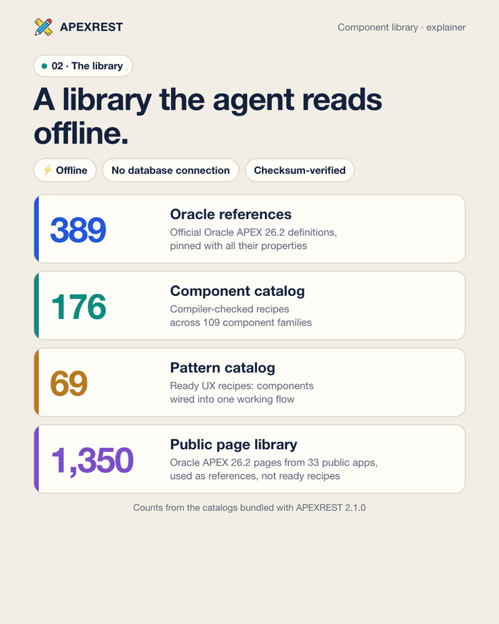
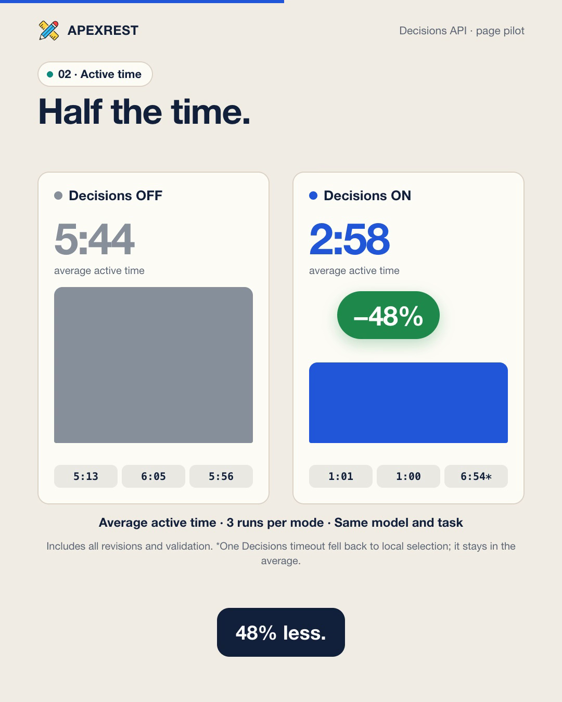
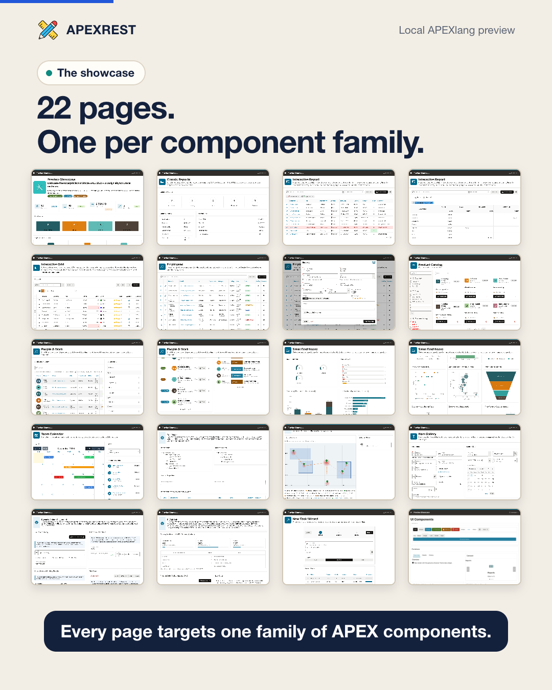
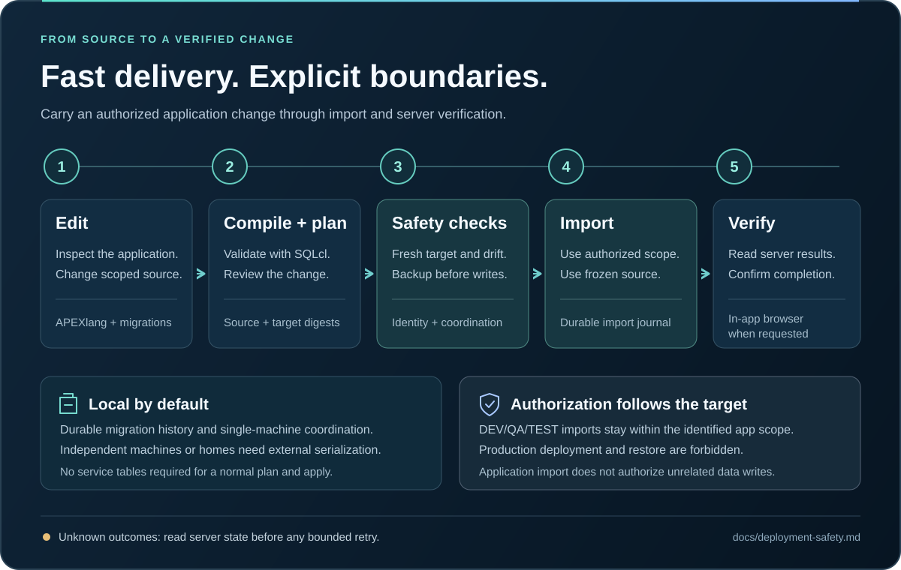

# APEXREST


[](https://github.com/apexrest-dev/apexrest/actions/workflows/ci.yml)

**An Oracle APEX plugin for Codex and Claude Code: build and change APEX applications from a conversation, from APEXlang source to a verified import.**

[Get started](https://apexrest-dev.github.io/apexrest/getting-started/) · [Documentation](https://apexrest-dev.github.io/apexrest/docs/) · [Local preview](docs/local-preview.md) · [Component catalog](docs/component-catalog.md) · [Deployment safety](https://apexrest-dev.github.io/apexrest/deployment/) · [Verification status](https://apexrest-dev.github.io/apexrest/implementation-status/)

## What APEXREST is

[Oracle APEX](https://apex.oracle.com/) is a low-code platform for business web applications on Oracle Database: forms, reports, dashboards and internal tools. APEX 26.1 and 26.2 can express an application as **APEXlang**, a readable text source that a coding agent can edit like any other code.

APEXREST is the framework that lets a coding agent do this work well. It ships as **one plugin for two hosts**:

| Host                                | What you install                                                    | How you use it                                           |
| ----------------------------------- | ------------------------------------------------------------------- | -------------------------------------------------------- |
| **Codex** (desktop app and CLI)     | `apexrest-apex` from the `apexrest` marketplace                     | Describe the change, or invoke `$apexrest-work`          |
| **Claude Code** (CLI, desktop, IDE) | `apexrest` from the `apexrest` marketplace                          | Describe the change, or invoke `/apexrest:apexrest-work` |
| Scripts, CI and Codex Cloud         | The `apexrest` CLI from the same bundle (`npm install -g apexrest`) | The same operations as commands, with JSON output        |

Inside the plugin, **six skills** tell the agent how to work and **eleven MCP tools** do the work through one shared runtime that drives Oracle SQLcl. A request such as "add an order status report" becomes:

1. **Grounded APEXlang.** The agent looks up pinned Oracle definitions and compiler-checked recipes in an offline component library instead of guessing properties.
2. **A local look.** The agent can render the pages on your machine, without a database, and click through them.
3. **A real compiler check.** The official Oracle compiler validates the sources and returns structured diagnostics.
4. **A reviewed import.** An exact plan, a backup, then an authorized import of only the changed pages and components into a development or test application.
5. **A browser check.** On request, the agent opens the changed pages and records what it actually saw.

Production targets are always blocked. Each outcome (compiled, imported, seen in a browser) is reported separately and never inferred from another.

## Watch the main features

<table>
<tr>
<td align="center" width="33%"><a href="docs/assets/apexrest-component-library.mp4"></a><br><b>Component library</b><br>1:41 · <a href="docs/assets/apexrest-component-library.mp4">MP4</a> · <a href="docs/assets/apexrest-component-library.srt">SRT</a></td>
<td align="center" width="33%"><a href="docs/assets/apexrest-decisions-pilot.mp4"></a><br><b>Decisions API selection</b><br>1:09 · <a href="docs/assets/apexrest-decisions-pilot.mp4">MP4</a> · <a href="docs/assets/apexrest-decisions-pilot.srt">SRT</a></td>
<td align="center" width="33%"><a href="docs/assets/apexrest-preview-showcase.mp4"></a><br><b>Run APEX locally</b><br>2:48 · <a href="docs/assets/apexrest-preview-showcase.mp4">MP4</a> · <a href="docs/assets/apexrest-preview-showcase.srt">SRT</a></td>
</tr>
</table>

The players below run on GitHub; the posters link to the same MP4 files in `docs/assets/`. Each video has English narration from a synthetic voice and burned-in captions. Provenance, data sources and limits are recorded in [docs/assets/README.md](docs/assets/README.md).

### 1. The component library: read before writing

https://github.com/user-attachments/assets/dddd2f88-66f6-4040-9359-13bb4ee999f4

A single Metric Card page is 69 lines of nested APEXlang, and every guessed property costs another compile round. APEXREST gives the agent an offline library to read first:

- **Oracle definitions.** The complete [26.2 Oracle inventory](https://apexrest-dev.github.io/apexrest/oracle-apexlang-coverage/): 389 definitions and 32,187 contextual property occurrences.
- **Compiler-checked recipes.** 109 component families with 176 recipes in the [component catalog](docs/component-catalog.md), and 58 UX patterns with 84 recipes, 69 of them compiler-checked, in the [pattern catalog](docs/pattern-catalog.md).
- **Reference pages.** 1,350 public Oracle pages.
- **Retrieval.** `apexrest_reference` searches plain English or Ukrainian terms, ranks ready recipes first and returns the top hit's code, with at most three lookups per change.
- **Recipes as contracts.** Each recipe carries a data shape, adaptation rules, working APEXlang, and compiler evidence bound to file checksums.

The video shows real APEXREST 2.1.0 search results, an `LOV_NOT_FOUND` compiler diagnostic and the passing validation after the fix. The user request and the compile-loop sketch are illustrations.

### 2. Decisions API: choose components before generating

https://github.com/user-attachments/assets/7136505b-c13c-4478-8473-318d4827062f

The optional [OpenAI Decisions selection](docs/component-catalog.md#optional-openai-decisions-selection) runs through `apexrest_reference mode:select` and `apexrest docs select`. One bounded predicate batch ranks up to 64 compatible local catalog candidates. The host model then writes the page from the verified local contracts. Disabled selection, search and read stay fully local.

In a one-page pilot, the same model built the same APEXlang page three times with selection and three times without it:

- Average active time fell from 5:44 to 2:58 (−48%).
- Main-model tokens fell from about 59,000 to 35,000. Decisions usage is additional.
- Two of three selected runs passed on the first generation.
- All six final pages passed the offline Oracle compiler and the same 46 checks.

This is a single-page pilot, not a general benchmark. The page in the video is a wireframe with synthetic data.

### 3. The local preview: run APEXlang without a database

https://github.com/user-attachments/assets/e1923958-59a8-4c09-bb1a-0ce94dd540bf

`apexrest preview` serves an APEXlang application from Node.js and SQLite on `127.0.0.1`. Pages render with the genuine Universal Theme 26.2 templates, CSS and JavaScript. You or the agent can open real pages, submit forms and see an `.apx` edit on the next reload, before anything is compiled or imported. The video tours a 22-page showcase application with one page per component family. `preview check` renders all 22 pages with 0 errors and 0 warnings.

```sh
apexrest preview setup                        # once: extracts the APEX 26.2 browser runtime and theme templates
apexrest preview check --project /abs/app     # render every page, list what is not simulated
apexrest preview start --project /abs/app     # serve pages and print their URLs
```

| Area    | What runs locally                                                                                                                                                                                              |
| ------- | -------------------------------------------------------------------------------------------------------------------------------------------------------------------------------------------------------------- |
| Reports | Classic reports (every pagination type, directives); interactive reports with control break, highlight, compute, aggregate, Group By, Pivot, Chart and downloads; editable interactive grids and master-detail |
| Forms   | Modal dialogs, Form Initialization and DML, server validations shown inline, interactive grid row validations, lost-update detection                                                                           |
| Items   | Date pickers, popup LOV, combobox, cascading LOVs, shuttle, switch, star rating, color picker, rich text and markdown editors, QR code, file and image upload                                                  |
| Search  | Faceted Search and Smart Filters with live counts; cards with actions; list views; template components (Content Row, Timeline, Comments, Media List, Metric Card, …)                                           |
| Visuals | SVG charts (bar, line, area, combination, pie, donut, scatter, bubble, funnel, pyramid, radar, polar, range, gauges); FullCalendar calendars; offline maps; tree regions                                       |
| Logic   | Dynamic actions; a PL/SQL subset interpreter for processes, validations, computations and dynamic content; one transaction per submit with rollback on error                                                   |
| Data    | Oracle SQL semantics over SQLite; seed scripts; file uploads and BLOB downloads; `apex_collection`; local e-mail outbox; REST sources from JSON fixtures                                                       |
| Tools   | Developer toolbar: diagnostics, session state, debug log, "view as" roles, device sizes, data reset, theme styles; APEXlang property validation                                                                |

Why run APEXlang locally:

- **Speed.** Design feedback takes seconds, not a compile-and-import cycle.
- **No database.** You need no Oracle access and no shared workspace, and it works offline.
- **Safe experiments.** Data lives in local SQLite and resets at any time.
- **Agents can check their own work.** AI agents can open and click the pages they write.

The preview is a design aid, not Oracle evidence. Charts are SVG rather than Oracle JET, maps have no tiles, and anything it does not simulate is listed in diagnostics. Read the [local preview guide](docs/local-preview.md).

### More videos

**Scoped APEXlang updates in 90 seconds:** selective export, local edit, compiler validation, scope planning and a selected-file import ([MP4](docs/assets/apexrest-2-scoped-updates.mp4), [captions](docs/assets/apexrest-2-scoped-updates.srt)).

https://github.com/user-attachments/assets/0e024a0a-d8b2-4366-b87f-55496e3ad55d

**See the UI before it reaches a database:** the first local preview video, on Oracle's public HR demo app ([MP4](docs/assets/apexrest-local-preview.mp4), [captions](docs/assets/apexrest-local-preview.srt)).

https://github.com/user-attachments/assets/fc2fd0e4-ac1a-4ff8-b15d-6c3bad5d624a

## Install

The repository ships the built plugin under `plugins/apexrest-apex`, so you need no `npm ci` and no TypeScript build. Keep Node 24 LTS on `PATH` (supported range: Node 24–26). Oracle work needs Java 21 and a matching SQLcl: SQLcl 26.1.2 for APEX 26.1, and SQLcl 26.3 for [APEX 26.2](docs/apex-26.2.md). The local preview needs neither Java nor SQLcl.

**Codex** (desktop or CLI with native plugin support):

```sh
codex plugin marketplace add apexrest-dev/apexrest
codex plugin add apexrest-apex@apexrest
```

**Claude Code:**

```sh
claude plugin marketplace add apexrest-dev/apexrest
claude plugin install apexrest@apexrest
```

For a local checkout, pass its path to `marketplace add` instead of `apexrest-dev/apexrest`. Start a new session after installation. Then ask the agent to check your setup:

> Use APEXREST to check my setup. Report the compiler, connection and target checks that still need attention.

The agent calls `apexrest_status` (`detail: "doctor"`). When Java or SQLcl is missing, it previews and then runs the bundled installer:

1. `apexrest dependencies install --dry-run` shows what would be installed.
2. `apexrest dependencies install --yes` installs it. Adding `--accept-oracle-license` records your separate consent to the Oracle terms shown in the preview.

Installation never creates a database or deploys an application.

**CLI from npm** (optional; the same runtime without a host plugin):

```sh
npm install -g apexrest
apexrest --help
```

Use the current checkout's bundled runtime for the features documented here: `node plugins/apexrest-apex/runtime/apexrest.mjs --help`. The [installation guide](https://apexrest-dev.github.io/apexrest/getting-started/) covers connections, managed installation and removal.

> **Source version:** 2.5.0. Registry packages are a separate distribution path; use the repository bundle for its current features. See [current release notes](https://apexrest-dev.github.io/apexrest/release-notes/). Independent tooling; not an official Oracle, OpenAI or Anthropic product.

## Work in one session

Describe the change in the conversation, or invoke the work skill: `$apexrest-work` in Codex, `/apexrest:apexrest-work` in Claude Code. The skill follows the cycle below. Every project-scoped tool takes the absolute project directory as `project`.

1. **Project.**
   - New app: `apexrest_project` `action:init` with `directory` and `template` (`blank-app` or `customer-crm`) generates real Oracle sources.
   - Existing app: `action:inspect`. `apexrest_apex_sync` `action:status` shows a working copy.
2. **References.** Use at most three lookups per change: `apexrest_reference` `mode:search` with short terms, `kind` and `limit:3`, then `mode:read` on the chosen ID. `mode:select` adds optional Decisions ranking.
3. **Edit and preview.** Edit `.apx` files under the application source directory, keeping `.apex/apexlang.json`, Oracle IDs, authentication and authorization. `apexrest_preview` `action:start` serves the pages locally without a database. Previewing is not validation.
4. **Ship.** For ordinary authorized edits, make one `apexrest_ship` `mode:apply` call with `env` and `userRequest` (your literal instruction). The runtime then compiles, plans, records an exact-plan grant, backs up, imports, verifies and removes the grant. `importMode:auto` selects eligible changed pages and shared files, `files` binds exact paths, and other or global changes use the full application.
5. **Review when needed.** Use standalone `apexrest_apex_validate` for diagnostics, or `mode:plan` for an explicit review. Skip these duplicate calls during ordinary edits.
6. **Wait for completion.** If the call is still running after `waitSeconds`, read `apexrest_job` with the returned `jobId`. Never rerun ship to fetch a result.
7. **Verify when requested.** `apexrest_browser_open` returns the URL. The agent then opens it in the selected browser and checks rendering, navigation and the changed interaction.
8. **Report.** Files changed, validation result, ship status and `runId`, pages verified in the browser, and anything not verified with its reason.

An explicit request to create, update or import an identified DEV/QA/TEST application is the authorization for step 4, and the agent does not ask again. Production targets always block deployment and restore. Read the canonical [safety rules](https://apexrest-dev.github.io/apexrest/deployment/).

## Tools

| Tool                     | Purpose                                                                                                                                                               |
| ------------------------ | --------------------------------------------------------------------------------------------------------------------------------------------------------------------- |
| `apexrest_project`       | `init`, `adopt`, `inspect`, `connection_add`, `connection_list`, `connection_test`; passwords only through a private `passwordFile` or ignored local `envFile`        |
| `apexrest_reference`     | Offline Oracle APEXlang references, component recipes and UX patterns: `mode:search`, `mode:read` and optional Decisions `mode:select`                                |
| `apexrest_metadata_read` | Allowlisted, paginated metadata reads; `requests[]` batches up to 8 scoped queries with one target verification                                                       |
| `apexrest_apex_validate` | Real Oracle compiler on a staging copy, in-process, with structured diagnostics (`file`, `line`, `column`, `type`, `message`, `validValues`, `hint`)                  |
| `apexrest_ship`          | `mode:plan` validates and plans; `mode:apply` records a plan-bound grant, backs up, imports and verifies in a detached worker; `mode:recover` resumes a stopped `run` |
| `apexrest_apex_sync`     | Working source and trusted baseline for an existing dev/test app: `init`, `status`, `refresh`, `invalidate`                                                           |
| `apexrest_browser_open`  | Resolve the configured application URL for the host in-app browser (alias `codex`); opening is not verification                                                       |
| `apexrest_preview`       | Database-free local preview: `setup` once, `start` serves page URLs on loopback, `check` renders every page and lists unsupported features, `stop`, `status`          |
| `apexrest_job`           | `status` (waits up to 120 s, reports `phase`) and `cancel` for an existing `jobId`                                                                                    |
| `apexrest_artifact_read` | Bounded, sanitized text of a registered artifact                                                                                                                      |
| `apexrest_status`        | `doctor` probes SQLcl, Java and the host without downloads; `project` returns the read-only status snapshot (settings, connections, sync, jobs, deployments, grants)  |

Validation, planning, references, metadata and sync run inside the MCP server process on a pooled SQLcl engine. `ship` apply runs in a detached worker, so a database write survives host termination. The CLI keeps granular commands (`project`, `connection`, `apex`, `deploy`, `jobs`, `compose`, `sqlcl`, `dependencies`, `preview`) plus `ship`, `status`, `job` and `reference`; run `apexrest --help`.

## Skills

| Skill                      | Use                                                                                                                         |
| -------------------------- | --------------------------------------------------------------------------------------------------------------------------- |
| `apexrest-work`            | Create or change an application end to end: the eight-step cycle above                                                      |
| `apexrest-apexlang`        | Write or edit APEXlang with pinned Oracle references, component and pattern recipes, contract notes and compiler validation |
| `apexrest-safety`          | Authorization, trust, plan drift, unknown outcomes when `apexrest_ship` or `apexrest_job` is blocked or fails               |
| `apexrest-oracle-sync`     | Maintainer check/sync of official Oracle inventory, source hashes, new release discovery and full MCP retrieval coverage    |
| `apexrest-setup`           | Doctor, dependency installation, SQLcl mode and ORDS transport, connection references and the project status snapshot       |
| `apexrest-pattern-catalog` | Maintainers only: add reviewed UX patterns to the bundled catalog from an identified application                            |

The skills are host-neutral, and reference files load on demand. Compiler readiness does not imply SQL, import or browser verification.

## APEX 26.2: import only what changed

Update a page and its shared list of values without re-importing the rest of the application. APEXREST compares the saved baseline, local edits and a fresh server export. It preserves remote-only changes and blocks conflicts before writing.

| Import mode      | Use it for                                                                                                  |
| ---------------- | ----------------------------------------------------------------------------------------------------------- |
| `auto` (default) | Let the planner select eligible changed pages/shared components and explain when a full import is required. |
| `files`          | Import an explicit list, including required changed dependencies; never expand it to a full import.         |
| `full`           | Request the existing complete application import.                                                           |

Partial imports require:

- an existing dev/test application and a trusted sync baseline;
- APEX 26.2 sources and target;
- the reviewed SQLcl 26.3 compiler on a direct connection.

APEX 26.1 keeps full imports. See [APEX 26.2 partial imports](docs/apex-26.2.md).


## Oracle access

SQLcl runs in one of two modes: `cli` (a subprocess) or `mcp` (the official SQLcl stdio server). The database transport is either `direct` (the Oracle listener) or `ords` (REST-Enabled SQL over HTTPS, no port 1521). ORDS requires `cli` mode and plugin-level credentials kept in private local files, never in chat:

```sh
apexrest connection add dev-read --ords-url https://ords.example.invalid/ords/app_user/ --ords-username app_user --password-file /path/to/local/file
apexrest sqlcl configure --mode cli --database-transport ords --json
apexrest connection test dev-read --json
```

ORDS also enables the [Codex Cloud setup](https://apexrest-dev.github.io/apexrest/codex-cloud/): the bundled CLI runs inside the Cloud container and talks to your database over HTTPS. See [SQL through ORDS](https://apexrest-dev.github.io/apexrest/ords/).

## Deployment boundary

A plan binds sources, configuration, toolchain and target, and expires after 30 minutes. Apply then:

- re-checks identity and drift;
- keeps a checksummed APEXlang snapshot of the selected scope or the full application;
- freezes the sources;
- records migration history and ownership in a local durable store under `APEXREST_HOME`.

A clean supported APEX installation is enough: APEXREST creates no service tables. Coordination is local to one managed home, so independent machines need external serialization, such as one CI deploy job. An unknown outcome is never retried blindly. Read [deployment safety](https://apexrest-dev.github.io/apexrest/deployment/).



## Verification

Unit tests, mocked failure scenarios, real Oracle operations and native-host checks are recorded separately. A missing or skipped integration suite is not a passing result. See the [acceptance matrix](https://apexrest-dev.github.io/apexrest/acceptance.json), [implementation status](https://apexrest-dev.github.io/apexrest/implementation-status/) and [next actions](https://apexrest-dev.github.io/apexrest/next-actions/).

## Develop locally

Use Node 24 LTS and the committed lockfile:

```sh
npm ci --ignore-scripts
npm run build
npm run lint
npm run typecheck
npm run test:unit
npm run test:contracts
npm run test:installers
npm run site:build
npm run site:check
npm run test:packaging
npm run docs:check
```

After changing sources, skills or resources, run `npm run plugin:sync` to refresh the checked-in bundle, including the Codex and Claude Code manifests and both marketplace files. `npm run plugin:check` compares the bundle with a fresh build. `npm run release:dry-run` builds local artifacts and a readiness report, and nothing publishes a release. See [contributing](CONTRIBUTING.md) and [testing](https://apexrest-dev.github.io/apexrest/testing/).

## Documentation and support

The [documentation website](https://apexrest-dev.github.io/apexrest/) has searchable guides and catalogs:

- [Getting started](https://apexrest-dev.github.io/apexrest/getting-started/): install in Codex or Claude Code, connect, create or adopt, ship and verify.
- [Configuration](https://apexrest-dev.github.io/apexrest/configuration/): environments, connection references, trust policy and deployment coordination.
- [Testing](https://apexrest-dev.github.io/apexrest/testing/): repository checks and the browser verification rule.
- [Codex Cloud](https://apexrest-dev.github.io/apexrest/codex-cloud/): container setup, CLI over ORDS, secrets and proxies.
- [Architecture](https://apexrest-dev.github.io/apexrest/architecture/): one core behind the CLI, MCP and skills.
- [Troubleshooting](https://apexrest-dev.github.io/apexrest/troubleshooting/): setup, compiler, authorization and recovery diagnostics.
- [Security](SECURITY.md): credential boundaries, trusted code and private reports.
- [Composer](https://apexrest-dev.github.io/apexrest/composer/): experimental, CLI-only block composition, to be replaced by an App Spec compiler.

Report reproducible bugs through [GitHub issues](https://github.com/apexrest-dev/apexrest/issues) with sanitized diagnostics; follow [SECURITY.md](SECURITY.md) for sensitive reports. Licensed under [Apache-2.0](LICENSE).
