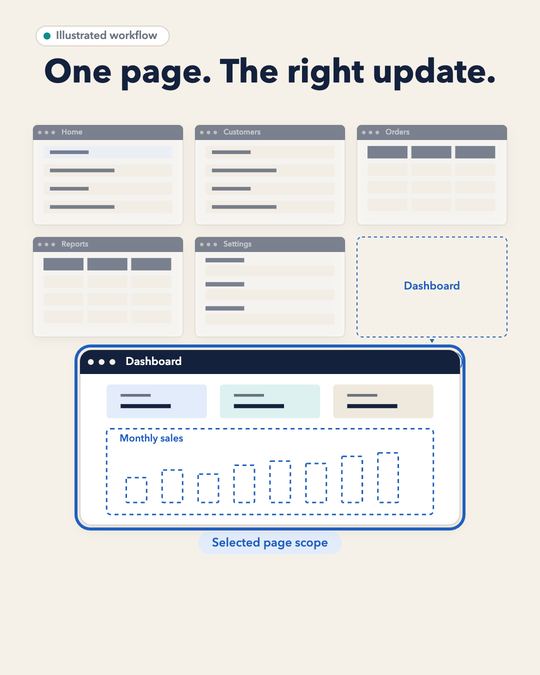
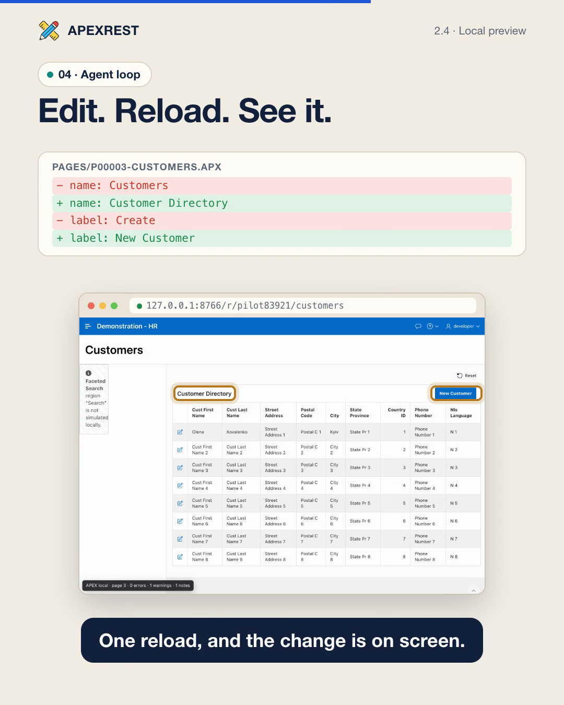

# APEXREST


[](https://github.com/apexrest-dev/apexrest/actions/workflows/ci.yml)

**Build and change Oracle APEX applications with Codex or Claude Code, from source to a verified import.**

Oracle APEX is a platform for building business web applications (forms, dashboards, reports and internal tools) on Oracle Database. APEXREST is a plugin for coding agents: a request such as "add an order status report" becomes APEXlang source changes, a real Oracle compiler check, a reviewed deployment plan, an authorized import into a development or test application and, when requested, a browser check of the result.

The plugin provides six skills and eleven MCP tools backed by one runtime that runs Oracle SQLcl. The same bundle installs into Codex (desktop and CLI) and Claude Code, and the `apexrest` CLI exposes the same operations for scripts and Codex Cloud.

[APEX 26.2 partial imports](docs/apex-26.2.md) · [Get started](https://apexrest-dev.github.io/apexrest/getting-started/) · [Documentation](https://apexrest-dev.github.io/apexrest/docs/) · [Deployment safety](https://apexrest-dev.github.io/apexrest/deployment/) · [Verification status](https://apexrest-dev.github.io/apexrest/implementation-status/)

## Watch: scoped APEXlang updates in 90 seconds

[](docs/assets/apexrest-2-scoped-updates.mp4)

[Watch the explainer (MP4, 1080×1350, English narration, burned-in captions)](docs/assets/apexrest-2-scoped-updates.mp4) · [Captions (SRT)](docs/assets/apexrest-2-scoped-updates.srt)

The video is an illustrated walkthrough of one page change: selective export, local edit, compiler validation, scope planning, APEXlang snapshot, selected-file import and readback, plus the shared-component boundary. Data, page names and the narrator voice are synthetic; it is not a recording of a live deployment or a benchmark.

## Watch: how the component library grounds APEXlang

[](docs/assets/apexrest-component-library.mp4)

[Watch the explainer (MP4, 1:41, 1080×1350, English narration, burned-in captions)](docs/assets/apexrest-component-library.mp4) · [Captions (SRT)](docs/assets/apexrest-component-library.srt)

A single Metric Card page is 69 lines of nested APEXlang, and every guessed property costs another compile round. The video shows how the agent reads before it writes:

- **Offline library:** pinned Oracle 26.2 definitions, the [component catalog](docs/component-catalog.md) and the [pattern catalog](docs/pattern-catalog.md) of compiler-checked recipes, and public Oracle pages kept as references.
- **Retrieval:** `apexrest_reference` searches plain English or Ukrainian terms, ranks ready recipes first and returns the top hit's code, with at most three lookups per change.
- **Recipe as a contract:** the data shape, adaptation rules, working APEXlang and compiler evidence bound to file checksums.
- **Validation:** the adapted page goes through the real Oracle compiler, which returns file, line, column and valid values for a mistyped property.
- **Shipping:** `apexrest_ship` handles the import. `ready` proves offline compilation only; SQL execution, import and browser checks are recorded separately.

The search results, the `LOV_NOT_FOUND` diagnostic and the passing validation are captured APEXREST 2.1.0 outputs. The user request, the compile-loop sketch and the narrator voice are illustrative or synthetic. No import or browser check was run for this video.

## Watch: see the UI before it reaches a database

[](docs/assets/apexrest-local-preview.mp4)

[Watch the explainer (MP4, 1:37, 1080×1350, English narration, burned-in captions)](docs/assets/apexrest-local-preview.mp4) · [Captions (SRT)](docs/assets/apexrest-local-preview.srt)

An agent can write an APEXlang page without ever seeing it; every design tweak normally means compile, import into a development database and reload. The [local preview](docs/local-preview.md) runs the sources on Node.js with SQLite instead of Oracle, using the Universal Theme 26.2 templates, CSS and JavaScript from the official distribution:

- **Live screens:** Oracle's public HR demo app with a report, a modal form, real validation messages, a save that refreshes the report, and an `.apx` edit visible on the next reload.
- **Whole-app check:** `apexrest preview check` rendered all 43 pages in about 0.2 seconds and listed what it could not simulate.
- **Scope:** a design aid, not Oracle evidence. PL/SQL runs through a local subset interpreter; APEX dictionary views, Oracle JET itself and authentication are not simulated; shipping still compiles and imports on DEV/QA/TEST.

All application screens are captured from the APEXREST 2.4.0 runtime with locally generated sample data. The agent message, code card and loop diagram are illustrations, and the narrator voice is synthetic. The preview has since grown well beyond what the video shows; see the next section.

## Watch: selecting components before generating a page

[](docs/assets/apexrest-decisions-pilot.mp4)

[Watch the explainer (MP4, 1:09, 1080×1350, English narration, burned-in captions)](docs/assets/apexrest-decisions-pilot.mp4) · [Captions (SRT)](docs/assets/apexrest-decisions-pilot.srt)

A one-page pilot of the optional [OpenAI Decisions selection](docs/component-catalog.md#optional-openai-decisions-selection): the same model built the same APEXlang page three times with and three times without selecting catalog components first. Average active time fell from 5:44 to 2:58 (−48%) and main-model tokens from about 59,000 to 35,000 (Decisions usage is additional); two of three selected runs passed on the first generation, and all six final pages passed the offline Oracle compiler and the same 46 checks. It is a single-page pilot with a fixed reference-reading policy, not a general benchmark; the page is a wireframe with synthetic data, no import or browser check was run, and the narrator voice is synthetic.

## APEX 26.2: import the pages and components you changed

**Update a page and its shared list of values without re-importing the rest of the application.** APEXREST can automatically select eligible changes or import an explicit list of `.apx` files. It compares the saved baseline, local edits and a fresh server export, preserves remote-only changes and blocks conflicts before writing.

| Import mode      | Use it for                                                                                                  |
| ---------------- | ----------------------------------------------------------------------------------------------------------- |
| `auto` (default) | Let the planner select eligible changed pages/shared components and explain when a full import is required. |
| `files`          | Import an explicit list, including required changed dependencies; never expand it to a full import.         |
| `full`           | Request the existing complete application import.                                                           |

> **Available in the 2.4.0 source bundle.** Partial imports require an existing dev/test app, a trusted sync baseline, APEX 26.2 sources and target, and the reviewed SQLcl 26.3 compiler using a direct connection. Both the CLI and `apexrest_ship` MCP tool support the feature. APEX 26.1 retains full imports.


> **Source version:** 2.4.0. Registry packages are a separate distribution path; use the repository bundle for its current features. See [current release notes](https://apexrest-dev.github.io/apexrest/release-notes/). Independent tooling; not an official Oracle, OpenAI or Anthropic product.

## Local preview: run the UI without Oracle

`apexrest preview` serves an APEXlang application from Node.js and SQLite on `127.0.0.1`, so an agent (or you) can open real pages, click through them and see design changes on the next reload, before anything is compiled or imported.

```sh
apexrest preview setup                        # once: extracts the APEX 26.2 browser runtime and theme templates
apexrest preview check --project /abs/app     # render every page, list what is not simulated
apexrest preview start --project /abs/app     # serve pages and print their URLs
```

| Area       | What runs locally                                                                                                                                                                                                                          |
| ---------- | ------------------------------------------------------------------------------------------------------------------------------------------------------------------------------------------------------------------------------------------ |
| Theme      | Genuine Universal Theme 26.2 templates, CSS and JavaScript; all page templates, navigation, theme styles (toolbar picker), messages and modal dialogs                                                                                      |
| Reports    | Interactive reports with Actions-menu views (control break, highlight, compute, aggregate, group by, pivot, chart, saved reports, .xlsx download), editable interactive grids saved to SQLite, classic reports with sorting and pagination |
| Search     | Faceted Search and Smart Filters on Oracle's own widget with live counts; cards, list views                                                                                                                                                |
| Components | Template components (Content Row, Media List, Metric Card, Timeline, …) with full template directives; tabs, carousel, region display selector, inline dialogs                                                                             |
| Visuals    | SVG charts (bar, line, area, combination, pie, donut, scatter, bubble, funnel, gauge, radar), FullCalendar calendars, offline maps                                                                                                         |
| Items      | Genuine widgets: date picker, popup LOV, combobox, shuttle, switch, star rating, color picker, markdown, QR; cascading LOVs                                                                                                                |
| Structure  | Tree regions with `connect by` queries, search regions, wizards (next/previous page, form pagination), tabular forms and legacy regions                                                                                                    |
| Logic      | PL/SQL subset interpreter for processes, validations, conditions, computations, branches and dynamic content; the dynamic action runtime; Oracle SQL shims and sample tables                                                               |
| Data       | File uploads and BLOBs, downloads, data loading from CSV/JSON/XML/XLSX, `apex_collection`, APEX dictionary views generated from the source, local e-mail outbox, REST sources from JSON fixtures                                           |
| Tools      | Developer toolbar: diagnostics, session state, debug log, "view as" roles, tablet/phone viewport, page list, data reset, theme-style picker                                                                                                |

All 91 pages of Oracle's three public APEXlang example applications render with no errors or warnings, including their administration pages. Anything not simulated is reported in a page toolbar and by `check`, never hidden. The preview is a design aid, not compiler, import or Oracle evidence. Read the [local preview guide](docs/local-preview.md).

## Install

The repository ships the built plugin under `plugins/apexrest-apex`, so no `npm ci` or TypeScript build is needed. Keep Node 24 LTS on `PATH` (supported range: Node 24–26). Oracle work needs Java 21 and a matching SQLcl: the managed default for APEX 26.1 is SQLcl 26.1.2; [APEX 26.2 support](docs/apex-26.2.md) uses SQLcl 26.3 and adds automatic or explicit partial imports for eligible pages and shared components.

**Codex** (desktop or CLI with native plugin support):

```sh
codex plugin marketplace add apexrest-dev/apexrest
codex plugin add apexrest-apex@apexrest
```

**Claude Code:**

```sh
claude plugin marketplace add apexrest-dev/apexrest
claude plugin install apexrest@apexrest
```

For a local checkout, pass its path to `marketplace add` instead of `apexrest-dev/apexrest`. Start a new session after installation. Then ask the agent to check your setup:

> Use APEXREST to check my setup. Report the compiler, connection and target checks that still need attention.

The agent calls `apexrest_status` (`detail: "doctor"`) and, when Java or SQLcl is missing, previews and runs the bundled installer (`apexrest dependencies install --dry-run`, then `--yes`; `--accept-oracle-license` records your separate consent to the Oracle terms shown in the preview). Installation never creates a database or deploys an application.

**CLI from npm** (optional; the same runtime without a host plugin):

```sh
npm install -g apexrest
apexrest --help
```

Use the current checkout's bundled runtime for the features documented here: `node plugins/apexrest-apex/runtime/apexrest.mjs --help`. The [installation guide](https://apexrest-dev.github.io/apexrest/getting-started/) covers connections, managed installation and removal.

## Work in one session

Describe the change in the conversation or invoke the work skill: `$apexrest-work` in Codex, `/apexrest:apexrest-work` in Claude Code. The skill follows this cycle, with every project-scoped tool taking the absolute project directory as `project`:

1. **Project.** New app: `apexrest_project` `action:init` with `directory` and `template` (`blank-app` or `customer-crm`) generates real Oracle sources. Existing app: `action:inspect`; `apexrest_apex_sync` `action:status` shows a working copy.
2. **References**, at most three lookups per change: `apexrest_reference` `mode:search` with short terms, `kind` and `limit:3`, then `mode:read` the chosen ID.
3. **Edit** `.apx` files under the application source directory, keeping `.apex/apexlang.json`, Oracle IDs, authentication and authorization. For design work, `apexrest_preview` `action:start` serves the pages locally without a database; it is not validation.
4. **Ship** ordinary authorized edits with one `apexrest_ship` `mode:apply` call, `env` and `userRequest` (your literal instruction). The shared runtime compiles, plans, records an exact-plan grant, backs up, imports, verifies and removes the grant. `importMode:auto` selects eligible changed pages/shared files; `files` binds exact paths; other/global changes use the full application.
5. **Review when needed.** Use standalone `apexrest_apex_validate` for diagnostics or `mode:plan` for an explicit review; omit these duplicate calls during ordinary edits. A separate `mode:apply` prepares a fresh plan; granular `deploy apply` consumes a particular saved plan after review.
6. **Wait for completion.** If the call is still running after `waitSeconds`, read `apexrest_job` with the returned `jobId`; never rerun ship to fetch a result.
7. **When requested, verify** visibly changed pages: `apexrest_browser_open` returns the URL, then the agent opens it with the selected browser (`host`, legacy alias `codex`) and checks rendering, navigation and the changed interaction.
8. **Report** files changed, validation result, ship status and `runId`, pages verified in the browser, and anything not verified with its reason.

An explicit request to create, update or import an identified DEV/QA/TEST application is the authorization for step 4; the agent does not ask again. Production targets always block deployment/restore. Actual local DEV/QA/TEST targets allow all task-scoped DB changes; remote dangerous operations require human confirmation of the exact reviewed plan. Read the canonical [safety rules](https://apexrest-dev.github.io/apexrest/deployment/). Blocked, failed or unknown outcomes follow `$apexrest-safety`; missing tools or connections follow `$apexrest-setup`.

## Tools

| Tool                     | Purpose                                                                                                                                                               |
| ------------------------ | --------------------------------------------------------------------------------------------------------------------------------------------------------------------- |
| `apexrest_project`       | `init`, `adopt`, `inspect`, `connection_add`, `connection_list`, `connection_test`; passwords only through a private `passwordFile` or ignored local `envFile`        |
| `apexrest_reference`     | Offline Oracle APEXlang references, component recipes and UX patterns: `mode:search` (any-term EN/UK ranking, top hit with its code block) and `mode:read`            |
| `apexrest_metadata_read` | Allowlisted, paginated metadata reads; `requests[]` batches up to 8 scoped queries with one target verification                                                       |
| `apexrest_apex_validate` | Real Oracle compiler on a staging copy, in-process, with structured diagnostics (`file`, `line`, `column`, `type`, `message`, `validValues`, `hint`)                  |
| `apexrest_ship`          | `mode:plan` validates and plans; `mode:apply` records a plan-bound grant, backs up, imports and verifies in a detached worker; `mode:recover` resumes a stopped `run` |
| `apexrest_apex_sync`     | Working source and trusted baseline for an existing dev/test app: `init`, `status`, `refresh`, `invalidate`                                                           |
| `apexrest_browser_open`  | Resolve the configured application URL for the host in-app browser (alias `codex`); opening is not verification                                                       |
| `apexrest_preview`       | Database-free local preview: `setup` once, `start` serves page URLs on loopback, `check` renders every page and lists unsupported features, `stop`, `status`          |
| `apexrest_job`           | `status` (waits up to 120 s, reports `phase`) and `cancel` for an existing `jobId`                                                                                    |
| `apexrest_artifact_read` | Bounded, sanitized text of a registered artifact                                                                                                                      |
| `apexrest_status`        | `doctor` probes SQLcl, Java and the host without downloads; `project` returns the read-only status snapshot (settings, connections, sync, jobs, deployments, grants)  |

Validation, planning, references, metadata and sync run inside the MCP server process on a pooled SQLcl engine; `ship` apply runs in a detached worker so a database write survives host termination. The tool catalog is about 13 KB. The CLI keeps granular commands (`project`, `connection`, `apex`, `deploy`, `jobs`, `compose`, `sqlcl`, `dependencies`, `preview`) plus `ship`, `status`, `job` and `reference`; run `apexrest --help`.

## Skills

| Skill                      | Use                                                                                                                         |
| -------------------------- | --------------------------------------------------------------------------------------------------------------------------- |
| `apexrest-work`            | Create or change an application end to end: the eight-step cycle above                                                      |
| `apexrest-apexlang`        | Write or edit APEXlang with pinned Oracle references, component and pattern recipes, contract notes and compiler validation |
| `apexrest-safety`          | Authorization, trust, plan drift, unknown outcomes when `apexrest_ship` or `apexrest_job` is blocked or fails               |
| `apexrest-oracle-sync`     | Maintainer check/sync of official Oracle inventory, source hashes, new release discovery and full MCP retrieval coverage    |
| `apexrest-setup`           | Doctor, dependency installation, SQLcl mode and ORDS transport, connection references and the project status snapshot       |
| `apexrest-pattern-catalog` | Maintainers only: add reviewed UX patterns to the bundled catalog from an identified application                            |

Invoke a skill as `$apexrest-work` in Codex or `/apexrest:apexrest-work` in Claude Code, or describe the change and let the host select it. The skills are host-neutral; the linked local evidence reports their exact `SKILL.md` byte count; reference files load on demand. Complete [26.2 Oracle inventory](https://apexrest-dev.github.io/apexrest/oracle-apexlang-coverage/): 389 definitions and 32,187 contextual property occurrences. Independent 26.1 offline UX catalogs: 109 component families with 176 compiler-checked recipes ([component catalog](https://apexrest-dev.github.io/apexrest/component-catalog/)) and 58 UX patterns with 84 recipes, 69 compiler-checked ([pattern catalog](https://apexrest-dev.github.io/apexrest/pattern-catalog/)). Compiler readiness does not imply SQL, import or browser verification.

## Oracle access

SQLcl runs in `cli` mode (subprocess) or `mcp` mode (the official SQLcl stdio server); the database transport is `direct` (Oracle listener) or `ords` (REST-Enabled SQL over HTTPS, no port 1521). ORDS requires `cli` mode and plugin-level credentials kept in private local files, never in chat:

```sh
apexrest connection add dev-read --ords-url https://ords.example.invalid/ords/app_user/ --ords-username app_user --password-file /path/to/local/file
apexrest sqlcl configure --mode cli --database-transport ords --json
apexrest connection test dev-read --json
```

ORDS also enables the [Codex Cloud setup](https://apexrest-dev.github.io/apexrest/codex-cloud/): the bundled CLI runs inside the Cloud container and talks to your database over HTTPS. See [SQL through ORDS](https://apexrest-dev.github.io/apexrest/ords/).

## Deployment boundary

A plan binds sources, configuration, toolchain and target and expires after 30 minutes. Apply re-checks identity and drift, retains a checksummed APEXlang snapshot of the selected scope or full application, freezes the sources and records migration history and ownership in a local durable store under `APEXREST_HOME`. A clean supported APEX installation is sufficient: no APEXREST service tables exist or are created. Coordination is local to one managed home; independent machines need external serialization (for example one CI deploy job). An unknown outcome is never retried blindly. Read [deployment safety](https://apexrest-dev.github.io/apexrest/deployment/).


## Verification

Unit tests, mocked failure scenarios, real Oracle operations and native-host checks are recorded separately. See the [acceptance matrix](https://apexrest-dev.github.io/apexrest/acceptance.json), [implementation status](https://apexrest-dev.github.io/apexrest/implementation-status/) and [next actions](https://apexrest-dev.github.io/apexrest/next-actions/). A missing or skipped integration suite is not a passing result. The Claude usage adapter is implemented and verified on a historical transcript; its scripted two-turn check remains pending. Reusable qualification includes 67 APEX 26.1 baseline/quality cases and separate 26.2, agent, host and Bitcoin catalogs.

## Develop locally

Use Node 24 LTS and the committed lockfile:

```sh
npm ci --ignore-scripts
npm run build
npm run lint
npm run typecheck
npm run test:unit
npm run test:contracts
npm run test:installers
npm run site:build
npm run site:check
npm run test:packaging
npm run docs:check
```

After source, skill or resource changes, run `npm run plugin:sync` to refresh the checked-in bundle (including the Codex and Claude Code manifests and both marketplace files); `npm run plugin:check` compares it with a fresh build. `npm run test:repository-plugin` installs the bundle into an isolated Codex profile. `npm run release:dry-run` builds local artifacts and a readiness report; nothing publishes a release. See [contributing](CONTRIBUTING.md) and [testing](https://apexrest-dev.github.io/apexrest/testing/).

## Documentation and support

Read the [documentation website](https://apexrest-dev.github.io/apexrest/) with searchable guides and catalogs. Preview the tracked output with `npm run site:build` and `npm run site:preview`, then open `http://127.0.0.1:4173/apexrest/`. See the [Pages authoring guide](https://apexrest-dev.github.io/apexrest/publishing/#documentation-on-github-pages).

- [Getting started](https://apexrest-dev.github.io/apexrest/getting-started/): install in Codex or Claude Code, connect, create or adopt, ship and verify.
- [Configuration](https://apexrest-dev.github.io/apexrest/configuration/): environments, connection references, trust policy and deployment coordination.
- [Testing](https://apexrest-dev.github.io/apexrest/testing/): repository checks and the browser verification rule.
- [Codex Cloud](https://apexrest-dev.github.io/apexrest/codex-cloud/): container setup, CLI over ORDS, secrets and proxies.
- [Architecture](https://apexrest-dev.github.io/apexrest/architecture/): one core behind the CLI, MCP and skills.
- [Troubleshooting](https://apexrest-dev.github.io/apexrest/troubleshooting/): setup, compiler, authorization and recovery diagnostics.
- [Security](SECURITY.md): credential boundaries, trusted code and private reports.
- [Composer](https://apexrest-dev.github.io/apexrest/composer/): experimental, CLI-only block composition, to be replaced by an App Spec compiler.

Report reproducible bugs through [GitHub issues](https://github.com/apexrest-dev/apexrest/issues) with sanitized diagnostics; follow [SECURITY.md](SECURITY.md) for sensitive reports. Licensed under [Apache-2.0](LICENSE).
