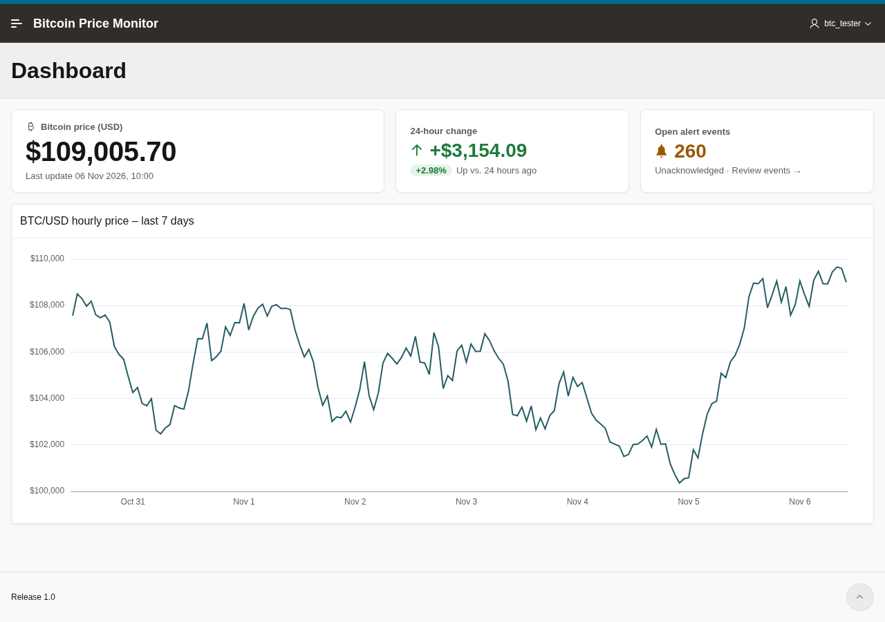
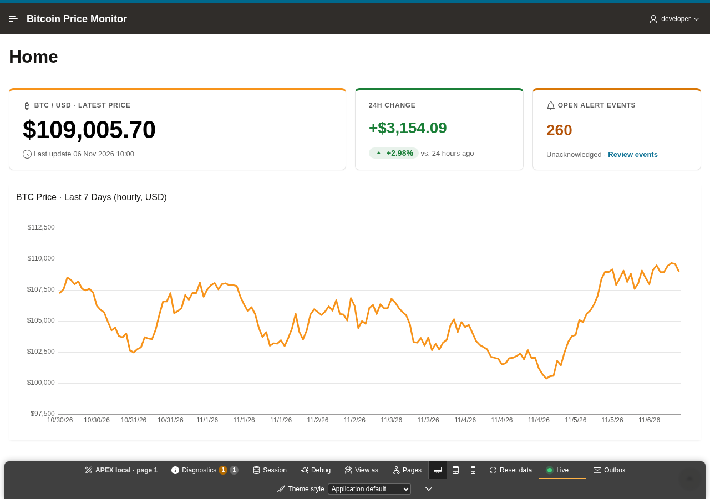
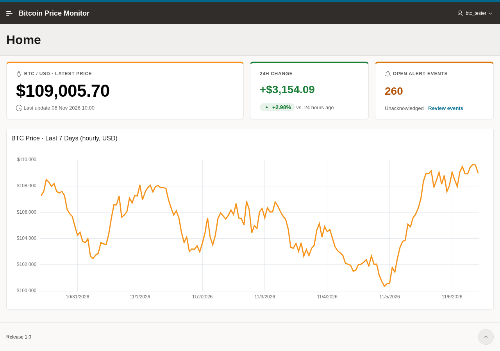
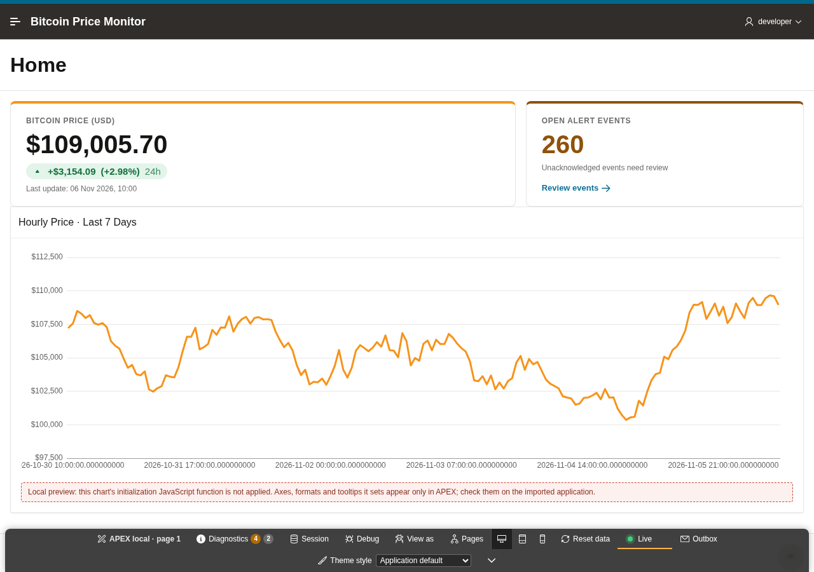

# Two agents, one dashboard: what the APEXREST plugin changes

_A field report from 6–7 November 2026. Every figure below comes from recorded runs on a local Oracle database. Each setup ran once, and the limits are listed at the end._

## The commission

Imagine you hire a tailor to make a suit. A good tailor does not cut the cloth once and hand it over. They pin, step back, look in the mirror, adjust a seam and look again. Most of the craft happens in those small fittings.

Now imagine a tailor without a mirror. To see each adjustment, they have to send the jacket across town to a factory, wait for it to be sewn properly, collect it, and only then look. The suit can still end up beautiful, but every fitting costs a trip.

That is the whole story of this experiment. The rest is detail.

We gave an AI coding agent (Claude Code, using the claude-opus-5-5 model) the same commission twice: build an [Oracle APEX](https://apex.oracle.com/) application called **Bitcoin Price Monitor**. It needed five pages on tables that already held a month of hourly prices:

- a dashboard with the latest price, the 24-hour change and a 7-day price chart;
- a price history report;
- an alerts page with a pop-up form to create, edit and delete alerts;
- an alert events page with a filter and an "acknowledge all" button;
- a navigation menu.

We added one demanding clause: **open the dashboard in a real Chrome browser, look at it with a designer's eye, and keep fixing it until it looks professional.** That meant a clear hierarchy for the price, a colored change, even spacing and a readable chart. Then the agent had to import the application again and look once more.

Both agents started from the same empty application, with the same database, the same model and the same browser. One difference separated them.

## The two workshops

**The first agent worked the traditional way.** It had Oracle's own APEXlang guide, which describes the text format an APEX application can be written in, and SQLcl, Oracle's command-line tool for compiling and importing applications. This is a perfectly respectable workshop. It is also the tailor without a mirror: to see any change, the agent has to compile the application, import it into APEX on the database server, reload the page in the browser and look.

**The second agent had APEXREST installed.** A _plugin_ is a set of extra tools you add to an AI assistant, much like a power tool you add to a workbench. The assistant stays the same; it just has better instruments. APEXREST gives it four:

1. **A component library.** It holds working building blocks taken from Oracle's own sample applications, so the agent adapts a real chart, form or card instead of writing one from memory.
2. **The Oracle compiler with repair hints.** When something is wrong, the error message also says how to fix it.
3. **A local APEX that runs on the agent's own machine** (Node.js) using live data from the development database, with every change rolled back. When the agent saves a file, the open page reloads at once. **This is the mirror.**
4. **A safe shipping step.** It plans the import, takes a backup, imports into the development application and checks that it landed in the right place.

## The race

### Without the plugin: the trip across town

The first agent read Oracle's guide by running dozens of shell commands. It wrote the pages, compiled them and imported the first version after a little over **8 minutes**. Then it opened Chrome, signed in and started looking.

It looked carefully, and the design work was good. In a narrow browser window the three price cards stacked on top of each other and pushed the chart below the fold, so it reorganized them. It colored the 24-hour change green and gave the open-events count an amber bell. It fixed the chart's Y-axis so it no longer started at zero and the price line stopped looking flat, and it made the tooltip show the hour and the exact price.

But every one of those touches went through the same trip: **edit, compile, import into APEX, reload, look.** After the first import that loop ran **7 more times**, plus one import attempt that never reported success. The polishing phase alone took about **13 minutes**. The run finished after **22 minutes 11 seconds** and cost **$8.04** in model usage.

### With the plugin: the mirror in the workshop

The second agent asked the component library, in one request, for everything it needed: a chart, cards, an interactive report, a modal form, a switch and buttons. It got working blocks back, looked up a few details, and wrote its first page after about **1.5 minutes**.

At about the **3-minute mark** it did something the first agent could not do: it started the **local APEX**, opened it in Chrome and began designing right there. This local APEX renders the real APEX look, the Universal Theme, using the real data from the development database. Nothing it does is saved: every change is rolled back. When the agent saves a file, the page in the browser updates almost instantly, so a fitting costs seconds instead of an import.

In the mirror it found what a designer finds. The first draft had a generic banner, four identical cards, a chart starting at zero, raw timestamps on the axis and a legend nobody needed. It fixed all of it. It then walked through the other pages and noticed that the alert filter rendered _below_ its report instead of above it, so it moved the filter, all before a single import.

Only then did it ship. The first import came at about **6.5 minutes**. In the real APEX the agent checked the chart again and found one detail the mirror had not shown: the tooltip showed only the date and a rounded price. It added the hour and the exact price, imported a second time, and finished.

**Total: 10 minutes 4 seconds, 2 imports, $5.01.**

## The scoreboard

|                                 |    Without the plugin | With APEXREST, run 1 | With APEXREST, run 2 |
| ------------------------------- | --------------------: | -------------------: | -------------------: |
| Total time                      |           22 min 11 s |   13 min 36 s (−39%) |    10 min 4 s (−55%) |
| Agent turns                     |                   192 |                  136 |                  121 |
| Imports into APEX               | 8 (+1 failed attempt) |                    2 |                    2 |
| Browser actions                 |                   124 |                   85 |                   63 |
| Model cost (API price estimate) |                 $8.04 |         $4.15 (−48%) |         $5.01 (−38%) |

All three applications compile without errors in the Oracle compiler and were imported into the development database. The dashboards look comparably professional. The plugin did not make the agent a better designer; it made each fitting cheaper, so the same care took less time.

## What the first plugin run taught us

The plugin ran twice because the first run exposed a crack in the mirror.

To label the chart's dates, that agent wrote a small JavaScript function of the kind APEX runs inside a chart. The local APEX draws charts with its own renderer, not Oracle's chart library, and it did not run that function, so the preview looked fine. In real APEX the dates turned into "NaN", and it took a second import to fix them. The warning existed, but only as a quiet line in the developer toolbar that the agent never read.

So we changed the mirror. Now, when a page has code the local APEX cannot run, a visible note appears right under the chart, and the plugin's own answer to the agent lists the code under `notAppliedLocally`, with a reminder to check it in real APEX:

The second run happened to use no such function, so the new warning did not come into play. Its second import came from the tooltip format, which the local renderer also draws differently from Oracle's charts. That is the next thing to make the mirror show. The rule stands either way: **the local APEX is for design; the final look at charts belongs in real APEX.** The plugin's workflow ends there on purpose.

## The fine print

- **One run per setup.** The two plugin runs took 816 and 604 seconds, so run-to-run variation is large. The second run was faster but cost more, because the agent re-read more context.
- **A narrow window.** The Chrome window was about 620 pixels wide in every run, so "desktop" was a squeezed desktop.
- **A guided prompt.** The plugin agent's instructions named its tools and asked for checks in the local APEX. The other agent was pointed at Oracle's guide.
- **Synthetic data, a local target.** The test used Oracle Database Free on the same machine. Neither agent clicked buttons that change data (delete, acknowledge all) in the browser.
- **Model cost** is an estimate at API prices for the Claude model only.

## The moral

When design happens in a browser, most of the time goes into the loop: _change, import, reload, look_. APEXREST takes the import out of that loop. In this test the agent imported 2 times instead of 8, finished 39–55% sooner and spent 38–48% less. The careful final look in real APEX stays, because that is where the suit is worn.

Want to try it? Start with [Getting started](getting-started.md), see the [local preview](local-preview.md) in detail, or read how imports stay safe in [deployment safety](deployment-safety.md).
