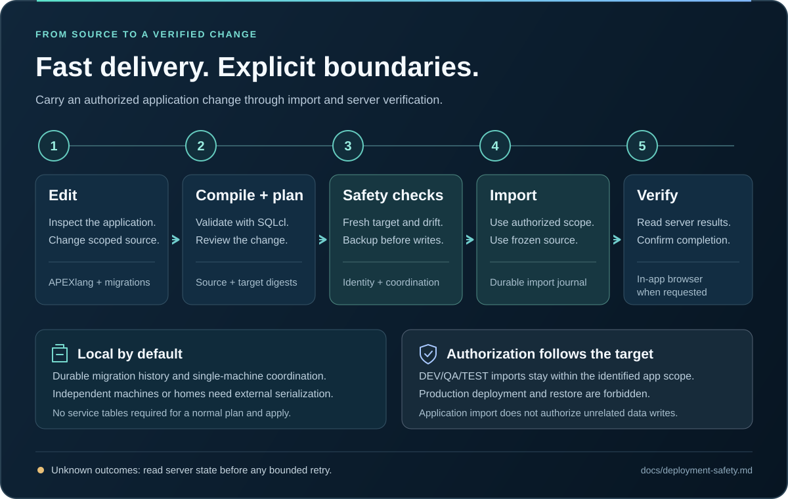

# Features and videos

APEXREST is one Oracle APEX plugin for Codex and Claude Code. This page explains its main capabilities. The video series on YouTube shows each one with real screen captures and measured results.

## Video series

Watch the [Oracle APEX with AI agents](https://www.youtube.com/playlist?list=PLe3nsyhtHRGk) playlist in order. Each episode has English narration from a synthetic voice (Kokoro-82M) and English subtitles.

| #   | Watch                                                                                                    | Episode                                                                                  | Length |
| --- | -------------------------------------------------------------------------------------------------------- | ---------------------------------------------------------------------------------------- | ------ |
| 1   | [](https://youtu.be/JJNva5WGreA) | [APEXlang: Oracle APEX as source code, and agent skills](https://youtu.be/JJNva5WGreA)   | 7:30   |
| 2   | [](https://youtu.be/FXia3u3E5L0) | [The plugin for Codex and Claude Code](https://youtu.be/FXia3u3E5L0)                     | 8:49   |
| 3   | [](https://youtu.be/lswZLhfpmH0) | [APEX component library: how the agent picks proven parts](https://youtu.be/lswZLhfpmH0) | 6:04   |
| 4   | [](https://youtu.be/aGGKPqKG5kI) | [The Decisions API: picking APEX page components faster](https://youtu.be/aGGKPqKG5kI)   | 7:38   |
| 5   | [](https://youtu.be/l_JsL2q8ij4) | [Run Oracle APEX locally, no database](https://youtu.be/l_JsL2q8ij4)                     | 8:12   |
| 6   | [](https://youtu.be/WiudC_UkVQ8) | [Local Oracle APEX with your real database backend](https://youtu.be/WiudC_UkVQ8)        | 8:46   |
| 7   | [](https://youtu.be/zFN1-eS8BXo) | [APEX live preview over WebSocket](https://youtu.be/zFN1-eS8BXo)                         | 8:13   |

## Component library: read before writing

[Watch episode 3 on YouTube](https://youtu.be/lswZLhfpmH0)

A single Metric Card page is 69 lines of nested APEXlang, and every guessed property costs another compile round. APEXREST gives the agent an offline library to read before it writes:

- **Oracle definitions.** The complete [26.2 Oracle inventory](oracle-apexlang-coverage.md): 389 definitions and 32,187 contextual property occurrences.
- **Compiler-checked recipes.** The [component catalog](component-catalog.md) has 118 component families with 269 ready recipes. The [pattern catalog](pattern-catalog.md) has 58 UX patterns with 84 recipes, 69 of them compiler-checked.
- **Reference pages.** 1,350 public Oracle pages.
- **Retrieval.** `apexrest_reference` searches plain English or Ukrainian terms, ranks ready recipes first and returns the top hit's code. A change uses at most three lookups.
- **Recipes as contracts.** Each recipe carries a data shape, adaptation rules, working APEXlang, and compiler evidence bound to file checksums.

The episode shows real `docs search` and `docs read` results, the simple dashboard pattern adapted into a new page, an `LOV_NOT_FOUND` compiler diagnostic from a deliberate typo and the passing validation after the fix.

## Decisions API: choose components before generating

[Watch episode 4 on YouTube](https://youtu.be/aGGKPqKG5kI)

The optional [OpenAI Decisions selection](component-catalog.md#optional-openai-decisions-selection) runs through `apexrest_reference mode:select` and `apexrest docs select`. One bounded predicate batch ranks up to 64 compatible local catalog candidates. The host model then writes the page from the verified local contracts. When selection is disabled, search and read stay fully local.

In a one-page pilot, the same model built the same APEXlang page three times with selection and three times without it:

- Average active time fell from 5:44 to 2:58 (−48%).
- Main-model tokens fell from about 59,000 to 35,000. Decisions usage is additional.
- Two of three selected runs passed on the first generation.
- All six final pages passed the offline Oracle compiler and the same 46 checks.

This is a single-page pilot, not a general benchmark. The pilot page uses synthetic data.

## Local preview: run APEXlang without a database

[Watch episode 5 on YouTube](https://youtu.be/l_JsL2q8ij4)

`apexrest preview` serves an APEXlang application from Node.js and SQLite on `127.0.0.1`. Pages render with the genuine Universal Theme 26.2 templates, CSS and JavaScript. You or the agent can open real pages, submit forms and see an `.apx` edit on the next reload, before anything is compiled or imported. The episode tours a 22-page showcase application with one page per component family. `preview check` renders all 22 pages with 0 errors and 0 warnings.

```sh
apexrest preview setup                        # once: extracts the APEX 26.2 browser runtime and theme templates
apexrest preview check --project /abs/app     # render every page, list what is not simulated
apexrest preview start --project /abs/app     # serve pages and print their URLs
```

| Area    | What runs locally                                                                                                                                                                                              |
| ------- | -------------------------------------------------------------------------------------------------------------------------------------------------------------------------------------------------------------- |
| Reports | Classic reports (every pagination type, directives); interactive reports with control break, highlight, compute, aggregate, Group By, Pivot, Chart and downloads; editable interactive grids and master-detail |
| Forms   | Modal dialogs, Form Initialization and DML, server validations shown inline, interactive grid row validations, lost-update detection                                                                           |
| Items   | Date pickers, popup LOV, combobox, cascading LOVs, shuttle, switch, star rating, color picker, rich text and markdown editors, QR code, file and image upload                                                  |
| Search  | Faceted Search and Smart Filters with live counts; cards with actions; list views; template components (Content Row, Timeline, Comments, Media List, Metric Card, …)                                           |
| Visuals | SVG charts (bar, line, area, combination, pie, donut, scatter, bubble, funnel, pyramid, radar, polar, range, gauges); FullCalendar calendars; offline maps; tree regions                                       |
| Logic   | Dynamic actions; a PL/SQL subset interpreter for processes, validations, computations and dynamic content; one transaction per submit with rollback on error                                                   |
| Data    | Oracle SQL semantics over SQLite; seed scripts; file uploads and BLOB downloads; `apex_collection`; local e-mail outbox; REST sources from JSON fixtures                                                       |
| Tools   | Developer toolbar: diagnostics, session state, debug log, "view as" roles, device sizes, data reset, theme styles; APEXlang property validation                                                                |

Running APEXlang locally gives you:

- **Speed.** Design feedback takes seconds, not a compile-and-import cycle.
- **No database.** You need no Oracle access and no shared workspace, and it works offline.
- **Safe experiments.** Data lives in local SQLite and resets at any time.
- **Agents that check their own work.** AI agents can open and click the pages they write.

The preview is a design aid, not Oracle evidence. Charts are SVG rather than Oracle JET, maps have no tiles, and anything it does not simulate is listed in diagnostics. Read the [local preview guide](local-preview.md).

## Connected preview: run the backend in your database

[Watch episode 6 on YouTube](https://youtu.be/WiudC_UkVQ8)

The local UI can run its backend in your own DEV, QA or TEST database. Add `--env` and the Node.js preview opens one session through your saved SQLcl connection.

- **SQL.** Region, report, LOV and form SQL runs in Oracle as written, with page items as binds.
- **PL/SQL.** Processes, validations and conditions run as real PL/SQL blocks, including your own packages. Bind values flow back into the page.
- **APEX session.** When the application is installed in the target, a real APEX session makes `v()` and `apex_util` work inside packages.
- **Nothing persists.**
  - Every request ends with a rollback.
  - COMMIT and dynamic SQL in page code are never sent, and a tripwire catches commits from stored code.
  - Production is refused, and the database identity must match.

```sh
apexrest preview check --project /abs/app --env test   # every page against the real database
apexrest preview start --project /abs/app --env test   # local UI, data and PL/SQL in Oracle
```

The episode shows an original stock-control application on a demo Oracle Autonomous Database:

- all 17 pages checked in 24 seconds with 0 errors;
- a receipt posted through the project's package and then rolled back;
- an over-stock issue rejected with the package's own error message.

It is a verification aid, not import evidence. Read [Connected Oracle mode](local-preview.md#connected-oracle-mode).

## Live preview: the page follows the agent

[Watch episode 7 on YouTube](https://youtu.be/zFN1-eS8BXo)

Every preview page keeps a WebSocket to the local server, so the agent sees its changes without navigating or reloading.

- **Source edits.** Saving an `.apx` file reloads the open page, which takes about a quarter of a second on localhost. A typo shows its parse error, with file and line, on that page.
- **Data changes.** A write to a table redraws every region that reads it, in every tab and session. Views resolve to their base tables.
- **Presence.** The toolbar shows who views the page, so the agent can work as its own user while you watch as yours.
- **Safeguards.** Unsaved grid edits are never overwritten, forms only show a notice, refresh loops are blocked, and the socket stays on localhost.

In the episode, captured from the generated showcase app, four source edits reload the page in 241–291 ms, from file write to the page load event. A typo shows its error in 176 ms. One grid save refreshes 10 dashboard regions in another session within 57 ms. It is a design aid, not Oracle evidence. Read [Live updates over WebSocket](local-preview.md#live-updates-over-websocket).

## APEX 26.2: import only what changed

Update a page and its shared list of values without re-importing the rest of the application. APEXREST compares the saved baseline, local edits and a fresh server export. It preserves remote-only changes and blocks conflicts before writing.

| Import mode      | Use it for                                                                                                  |
| ---------------- | ----------------------------------------------------------------------------------------------------------- |
| `auto` (default) | Let the planner select eligible changed pages/shared components and explain when a full import is required. |
| `files`          | Import an explicit list, including required changed dependencies; never expand it to a full import.         |
| `full`           | Request the existing complete application import.                                                           |

Partial imports require:

- an existing dev/test application and a trusted sync baseline;
- APEX 26.2 sources and target;
- the reviewed SQLcl 26.3 compiler on a direct connection.

APEX 26.1 keeps full imports. See [APEX 26.2 partial imports](apex-26.2.md).

## Safe deployment

A plan binds sources, configuration, toolchain and target, and expires after 30 minutes. Apply then:

- re-checks identity and drift;
- keeps a checksummed APEXlang snapshot of the selected scope or the full application;
- freezes the sources;
- records migration history and ownership in a local durable store under `APEXREST_HOME`.

A clean supported APEX installation is enough: APEXREST creates no service tables. Coordination is local to one managed home, so independent machines need external serialization, such as one CI deploy job. An unknown outcome is never retried blindly. Production targets always block deployment and restore. Read [deployment safety](deployment-safety.md).



## Oracle access

SQLcl runs in one of two modes: `cli` (a subprocess) or `mcp` (the official SQLcl stdio server). The database transport is either `direct` (the Oracle listener) or `ords` (REST-Enabled SQL over HTTPS, no port 1521). ORDS requires `cli` mode and plugin-level credentials kept in private local files, never in chat:

```sh
apexrest connection add dev-read --ords-url https://ords.example.invalid/ords/app_user/ --ords-username app_user --password-file /path/to/local/file
apexrest sqlcl configure --mode cli --database-transport ords --json
apexrest connection test dev-read --json
```

ORDS also enables the [Codex Cloud setup](codex-cloud.md), where the bundled CLI runs inside the Cloud container and reaches your database over HTTPS. See [SQL through ORDS](ords.md).

## Work in one session

Describe the change in the conversation, or invoke the work skill: `$apexrest-work` in Codex, `/apexrest:apexrest-work` in Claude Code. The skill follows the cycle below. Every project-scoped tool takes the absolute project directory as `project`.

1. **Project.**
   - New app: `apexrest_project` `action:init` with `directory` and `template` (`blank-app` or `customer-crm`) generates real Oracle sources.
   - Existing app: `action:inspect`. `apexrest_apex_sync` `action:status` shows a working copy.
2. **References.** Use at most three lookups per change: `apexrest_reference` `mode:search` with short terms, `kind` and `limit:3`, then `mode:read` on the chosen ID. `mode:select` adds optional Decisions ranking.
3. **Edit and preview.** Edit `.apx` files under the application source directory, keeping `.apex/apexlang.json`, Oracle IDs, authentication and authorization. `apexrest_preview` `action:start` serves the pages locally without a database. Previewing is not validation.
4. **Ship.** For ordinary authorized edits, make one `apexrest_ship` `mode:apply` call with `env` and `userRequest` (your literal instruction). The runtime then compiles, plans, records an exact-plan grant, backs up, imports, verifies and removes the grant. `importMode:auto` selects eligible changed pages and shared files, `files` binds exact paths, and other or global changes use the full application.
5. **Review when needed.** Use standalone `apexrest_apex_validate` for diagnostics, or `mode:plan` for an explicit review. Skip these duplicate calls during ordinary edits.
6. **Wait for completion.** If the call is still running after `waitSeconds`, read `apexrest_job` with the returned `jobId`. Never rerun ship to fetch a result.
7. **Verify when requested.** `apexrest_browser_open` returns the URL. The agent then opens it in the selected browser and checks rendering, navigation and the changed interaction.
8. **Report.** Files changed, validation result, ship status and `runId`, pages verified in the browser, and anything not verified with its reason.

An explicit request to create, update or import an identified DEV/QA/TEST application is the authorization for step 4, and the agent does not ask again. Production targets always block deployment and restore. Read the canonical [deployment safety](deployment-safety.md) rules.

## Tools

| Tool                     | Purpose                                                                                                                                                                                             |
| ------------------------ | --------------------------------------------------------------------------------------------------------------------------------------------------------------------------------------------------- |
| `apexrest_project`       | `init`, `adopt`, `inspect`, `connection_add`, `connection_list`, `connection_test`; passwords only through a private `passwordFile` or ignored local `envFile`                                      |
| `apexrest_reference`     | Offline Oracle APEXlang references, component recipes and UX patterns: `mode:search`, `mode:read` and optional Decisions `mode:select`                                                              |
| `apexrest_metadata_read` | Allowlisted, paginated metadata reads; `requests[]` batches up to 8 scoped queries with one target verification                                                                                     |
| `apexrest_apex_validate` | Real Oracle compiler on a staging copy, in-process, with structured diagnostics (`file`, `line`, `column`, `type`, `message`, `validValues`, `hint`); `sourceDir` validates another APEXlang folder |
| `apexrest_ship`          | `mode:plan` validates and plans; `mode:apply` records a plan-bound grant, backs up, imports and verifies in a detached worker; `mode:recover` resumes a stopped `run`                               |
| `apexrest_apex_sync`     | Working source and trusted baseline for an existing dev/test app: `init`, `status`, `refresh`, `invalidate`                                                                                         |
| `apexrest_browser_open`  | Resolve the configured application URL for the host in-app browser (alias `codex`); opening is not verification                                                                                     |
| `apexrest_preview`       | Database-free local preview: `setup` once, `start` serves page URLs on loopback, `check` renders every page and lists unsupported features, `stop`, `status`                                        |
| `apexrest_job`           | `status` (waits up to 120 s, reports `phase`) and `cancel` for an existing `jobId`                                                                                                                  |
| `apexrest_artifact_read` | Bounded, sanitized text of a registered artifact                                                                                                                                                    |
| `apexrest_peer_review`   | `status` shows the other vendor CLI and the review mode; `review` asks it for a read-only, schema-checked verdict bound to a plan digest or a plan-less source review                               |
| `apexrest_status`        | `doctor` probes SQLcl, Java and the host without downloads; `project` returns the read-only status snapshot (settings, connections, sync, jobs, deployments, grants)                                |

Validation, planning, references, metadata and sync run inside the MCP server process on a pooled SQLcl engine. `ship` apply runs in a detached worker, so a database write survives host termination. The CLI keeps granular commands (`project`, `connection`, `apex`, `deploy`, `jobs`, `compose`, `sqlcl`, `dependencies`, `preview`) plus `ship`, `status`, `job` and `reference`; run `apexrest --help`.

## Skills

| Skill                      | Use                                                                                                                         |
| -------------------------- | --------------------------------------------------------------------------------------------------------------------------- |
| `apexrest-work`            | Create or change an application end to end: the cycle above                                                                 |
| `apexrest-apexlang`        | Write or edit APEXlang with pinned Oracle references, component and pattern recipes, contract notes and compiler validation |
| `apexrest-safety`          | Authorization, trust, plan drift, unknown outcomes when `apexrest_ship` or `apexrest_job` is blocked or fails               |
| `apexrest-oracle-sync`     | Maintainer check/sync of official Oracle inventory, source hashes, new release discovery and full MCP retrieval coverage    |
| `apexrest-setup`           | Doctor, dependency installation, SQLcl mode and ORDS transport, connection references and the project status snapshot       |
| `apexrest-pattern-catalog` | Maintainers only: add reviewed UX patterns to the bundled catalog from an identified application                            |

Invoke a skill as `$apexrest-work` in Codex or `/apexrest:apexrest-work` in Claude Code, or describe the change and let the host select it. The skills are host-neutral, and reference files load on demand. Compiler readiness does not imply SQL, import or browser verification.
