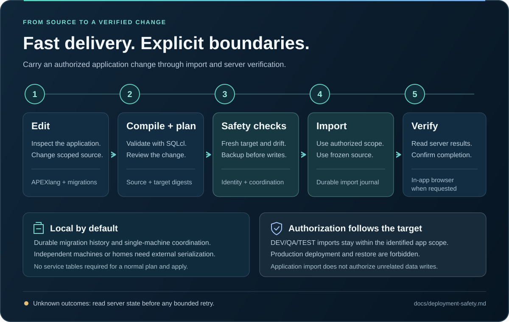

# From source to a verified application

This page summarizes the cycle that takes one change from APEXlang source to a verified application. For plugin installation, toolchain setup and your first application, follow the canonical [Getting started guide](../../docs/getting-started.md).

## The cycle

The `apexrest-work` skill (`$apexrest-work` in Codex, `/apexrest:apexrest-work` in Claude Code) drives one cycle per change:

1. Inspect the project (`apexrest_project`) or create it from a template. No folder trust list is required; see [getting started](../../docs/getting-started.md#create-or-adopt-a-project).
2. Read at most three references (`apexrest_reference`).
3. Edit the `.apx` sources, preserving Oracle IDs and `.apex` metadata.
4. Validate with the real Oracle compiler (`apexrest_apex_validate`) until there are no diagnostics.
5. Plan against the named environment (`apexrest_ship` `mode:plan`) and review risks, sources, target and `importSelection`. For qualified 26.2 apps, choose automatic or explicit partial import; see the [partial-import guide](../../docs/apex-26.2.md).
6. Apply with your explicit request as the authorization (`apexrest_ship` `mode:apply`); backup, identity and drift checks run first.
7. When requested, verify the changed pages in the built-in or selected browser (`apexrest_browser_open`).
8. Report what changed, what was verified and what was not.

## Related

- [Existing applications](../../docs/existing-app.md)
- [Deployment safety](../../docs/deployment-safety.md)
- [Testing](../../docs/testing.md)
